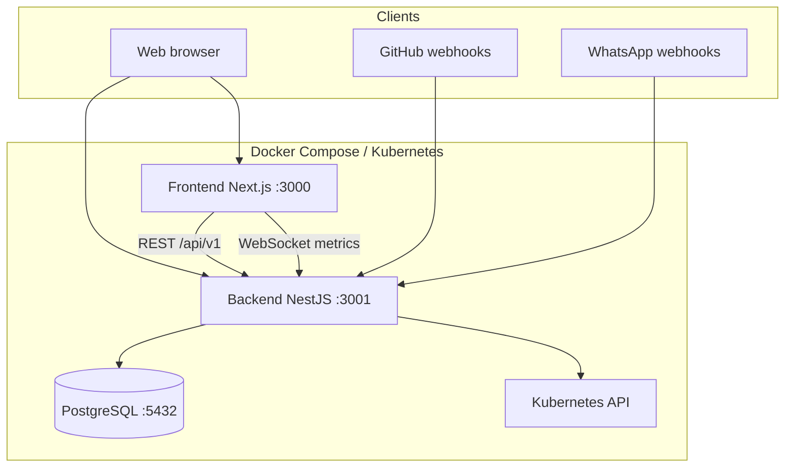

# Architecture

High-level design of the Amer DevOps Portal.

## System context

## Backend modules

| Module | Responsibility |
|--------|----------------|
| `AuthModule` | Login, register, JWT, `@Public()` routes |
| `DashboardModule` / `StatsModule` | Aggregated metrics, system status |
| `InfrastructureModule` | Deployments, services, configmaps |
| `ClusterModule` | Nodes, PVs, Helm, network policies |
| `LogsModule` | Pod logs, search, SSE stream |
| `AlertsModule` | Alert rules and firing alerts |
| `GithubModule` | Repos, Actions, webhooks |
| `PipelinesModule` | Workflow trigger, history, rollback |
| `ProjectsModule` | User-owned project records |
| `PlatformModule` | Observability, GitOps, topology, clusters |
| `SettingsModule` | Users, roles, API keys, audit, backup |
| `SecurityModule` | Image/deployment scans, app secrets |
| `LearningModule` | Jobs, paths, CV, certifications |
| `CollaborationModule` | Messages, channels, calendar |
| `IntegrationsModule` | Slack, outbound webhooks |
| `MetricsModule` | WebSocket gateway for live dashboard |
| `WebhookModule` | WhatsApp / inbound webhooks |

Global guards: `JwtAuthGuard`, `RolesGuard` (ADMIN for sensitive settings).

## Frontend architecture

- **App Router** under `src/app/` — one folder per major area
- **AuthContext** — login state, token in `localStorage`, redirect to `/login`
- **Lib layer** (`src/lib/*`) — typed fetch wrappers; no business logic in pages
- **Hooks** — WebSocket subscriptions, shared data fetching patterns

## Data layer

- **Prisma** is the single source of truth for schema
- Migrations in `backend/prisma/migrations/`
- Seed creates/updates default admin (`prisma/seed.ts`)
- Startup: `migrate deploy` → `db seed` → API (see `scripts/docker-entrypoint.sh`)

## Real-time

| Channel | Namespace | Purpose |
|---------|-----------|---------|
| Socket.IO | `/metrics` | Dashboard CPU/memory/network snapshots |
| Socket.IO | `/chat` | Collaboration messaging |

## External integrations

| Integration | Config | Notes |
|-------------|--------|-------|
| Kubernetes | `~/.kube/config` mount or in-cluster SA | Optional for local Docker |
| GitHub | Token via settings / env | Actions, repos, webhooks |
| WhatsApp | `WHATSAPP_*` env vars | Webhook verify + messaging |
| Slack | Integrations API | Notify channels |

## Security model

- Passwords: bcrypt (cost 10) in DB
- API: Bearer JWT (`Authorization` header)
- Roles: `USER`, `ADMIN`, `AGENT`
- `mustChangePassword` flag on user — force change on next login (settings flow)
- App secrets stored encrypted server-side (`SecurityModule`)

## Deployment topologies

### Local — Docker Compose

Three services: `postgres`, `backend`, `frontend` on bridge network `amer_portal_network`.

### Production — Kubernetes

Namespace `amer-portal`: Postgres, backend, frontend, Cloudflare Tunnel. Public traffic via Cloudflare edge; cluster not exposed directly. See [kubernetes/README.md](../kubernetes/README.md).

## Known technical debt

See [ROADMAP.md](ROADMAP.md) for prioritized fixes (webhook path duplication, partial UI wiring, K8s HTTP kubeconfig, etc.).
